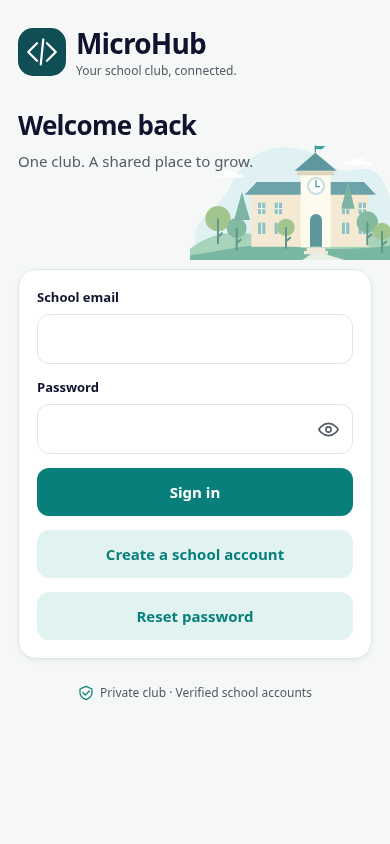
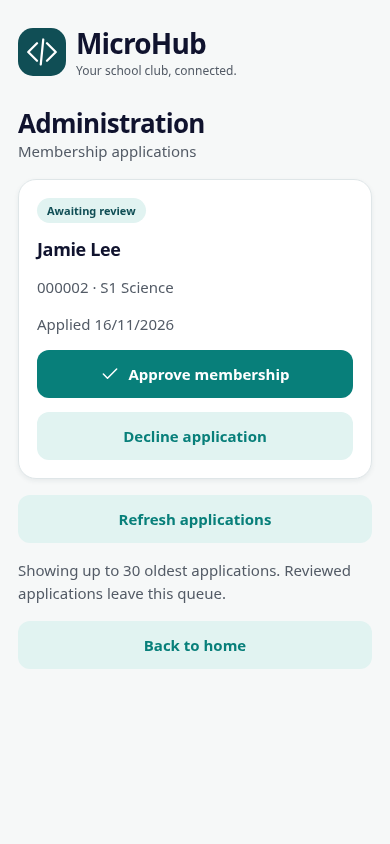

# Modern Campus UI redesign

Implemented on `codex/ui-redesign`, based on `codex/mvp-foundation` at `230ba27`. The reference is the Modern Campus dashboard image supplied in the conversation on 2026-11-16. The surrounding photographic phone, campus background and device status bar are presentation framing, not app UI.

## Reference analysis and design system

The screen uses an off-white background, navy typography, teal controls, pale mint selected states, softly elevated white cards and outlined icons. Its hierarchy is a brand/avatar header, a welcoming campus illustration, three summary tiles, then assignment, attendance, announcement and event cards. Spacing is calm but compact; the bottom navigation has a rounded top edge and a mint active pill.

Central tokens in `src/theme/tokens.ts` map this to `#F6F8F8` background, `#10132E` text, `#087F7A` primary, `#104E55` logo background, `#E1F3F1` mint surface, `#C2ECE9` selection and `#DFE6E8` borders. Cards use an 18-point radius, controls 12, and a subtle two-point elevation. Typography uses the platform sans-serif, with a 28-point brand, 26-point page title, 18-point section heading and 15-point body. There is no supplied licensed font or original illustration asset, so original scalable campus/study SVG artwork and consistent stroke icons are bundled. No remote image host is needed.

Shared controls are in `src/components/ui.tsx`; icon paths in `icon.tsx`; illustrations in `illustrations/campus.tsx`; dashboard composition in `dashboard.tsx`. Content has an 820-point maximum width, auth forms 480, with fluid narrow-screen layouts. Controls retain a minimum 44-point target, labels, live error alerts, font scaling and busy/disabled semantics. Password visibility is now an accessible icon within the field. Reusable cards, badges, rows and buttons cover error, pending, empty and active states.

## Screen coverage and deliberate differences

- Restyled existing login, registration, verification, password recovery, dashboard, member search, profile, application review and More screens.
- Kept the original five navigation destinations: Home, Homework, Attendance, Events, More. The reference's Members tab becomes the existing member directory links, preserving the original attendance workflow.
- The three dashboard tiles use actual membership, class and technical role. Reference sample counts, assignments, events and an unread notification dot are not inserted into live data.
- Homework, attendance and events retain their planned status. Added consistently styled, access-gated announcement, notification, resource and submission availability screens and an account/settings information screen. These do not implement V1/V2 feeds, delivery, settings persistence or submission storage. Their underlying feature-matrix statuses remain unchanged.
- Original image density is adapted to honest availability copy, mobile touch targets and variable-length names. This is a visual recreation of the design language and hierarchy, not a pixel-identical screenshot or a completed MVP.
- Existing Auth calls, school-email and password rules, membership RPCs, session handling, RLS and admin/member gates remain in place. No database migration, account/data change, SMTP update or hosted deployment was performed.

## Verification and screenshots

- `npm run check`: TypeScript, ESLint, 66 native/unit/component tests, 5 actual RN Web tests, 14 PostgreSQL behavioral scenarios (15 tests including the parent), Prettier.
- Expo Android, iOS and Web exports with SDK 58's compatible `react-native-svg` 15.16.0. Native exports are not installed-device tests.
- `scripts/visual-check.cjs`: Chromium interaction checks at 320×740, 390×844 and 820×1180. Covers signup rejection and verification transition, sign-in, profile save, directory, all new routes, member-hidden admin links and administrator approval. Checks horizontal overflow and browser runtime errors.
- Browser tests intercept only `https://microhub-preview.supabase.co/**` with synthetic identities and responses. Fixture data lives in the browser runner, never the app. Screenshots demonstrate UI and mocked-response interactions, not real school accounts, SMTP delivery or hosted RLS. No credentials are needed.
- Screenshots are saved in `docs/screenshots/`. Reviewed phone login/registration/home, compact phone layouts and tablet views against the supplied reference. Corrected excess dashboard card height and the active-tab corner shape after the first comparison.
- Physical Android/iOS, Safari, device text scaling and keyboard behavior still need acceptance. Real signup continues to depend on the user's SMTP configuration.

Selected rendered screenshots:

| Dashboard                                                    | Login                                         | Administration                                                            |
| ------------------------------------------------------------ | --------------------------------------------- | ------------------------------------------------------------------------- |
|  |  |  |

## Reproduce the local visual checks

The optional runner requires Playwright and Chromium on the machine; these are test tools, not Expo app dependencies. In this cloud environment Playwright is preinstalled and Chromium is `/usr/bin/chromium`. Elsewhere install Playwright in a disposable test workspace and set `CHROMIUM_PATH` to an available Chromium executable. The ordinary `npm run check` does not require a browser installation.

```bash
EXPO_OFFLINE=1 EXPO_PUBLIC_SUPABASE_URL=https://microhub-preview.supabase.co EXPO_PUBLIC_SUPABASE_PUBLISHABLE_KEY=sb_publishable_visual_review npx expo export --platform all --output-dir /tmp/microhub-ui-final
VISUAL_EXPORT_DIR=/tmp/microhub-ui-final node scripts/visual-check.cjs
```

These environment values are intentionally non-working fixture values, scoped to this one export command. Do not put them in your `.env`. The script serves only localhost, port 8091. It does not send requests to the actual school project.

## Preview in your existing Codespace

Stop the current Expo terminal using its trash icon and open a new terminal. Keep any unrelated local edits. Then:

```bash
git fetch origin
git switch codex/ui-redesign
npm install
npm run web -- --clear
```

Open the existing forwarded port 8081 in Safari. The original ignored `.env` stays in the Codespace. For Expo Go use `npx expo start --tunnel` instead. The added SVG module is compatible with this Expo SDK; the installed Expo Go version must also support SDK 58. No SQL needs rerunning.

To compare the original interface, stop Expo, switch back to `codex/mvp-foundation`, run `npm install` and restart. No automatic merge into that branch or `main` is part of this task.
