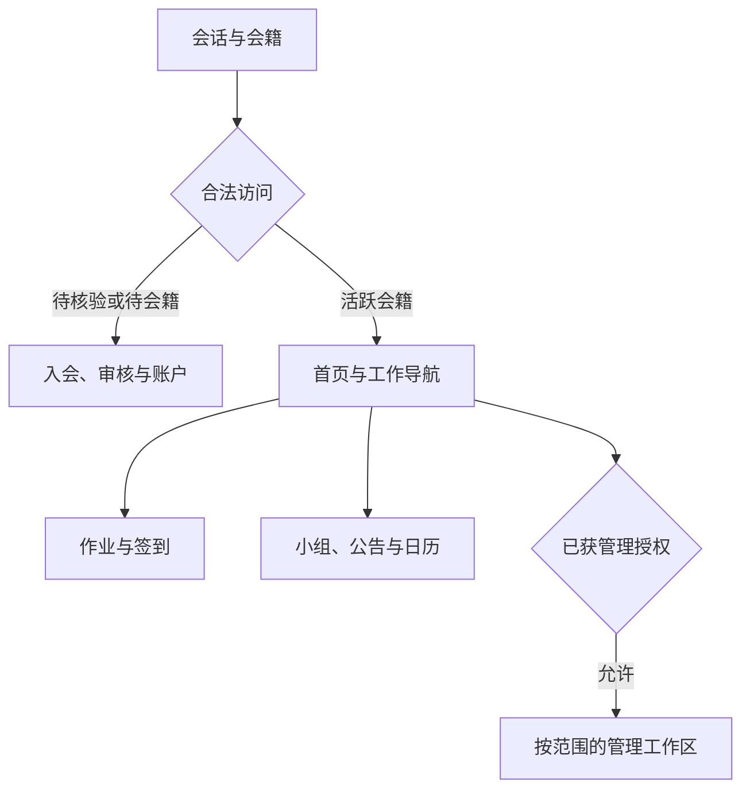

# 目标页面与导航

创建与最近更新 2026-11-28 · MicroHub 审计基线 `32150ab4bdd46327f52e42e2431dfaa0b5198b95`

Proposed。以下路径是审计基线的现有公开 URL，后端能力是可见性与授权的判断依据。页内状态可使用安全参数。移动底栏保留首页、作业、签到、我的小组、更多，保留熟悉的四个学会进入习惯。桌面侧栏同源生成，另给公告和活动日历区域入口；账户、语言和主题归账户菜单，桌面不重复提供“更多”作为主入口。平板与手机的日历从首页直达，More 保留次级入口。全局只在活跃会籍展示工作导航。

| 层级         | 普通成员                                                | 研教／带组人员（以实际授权为准）                          | 会长、副会长（已合入，托管依赖待核）                         |
| ------------ | ------------------------------------------------------- | --------------------------------------------------------- | ------------------------------------------------------------ |
| 首页         | 下一项作业、本人签到、重要公告、月历                    | 可管理范围的待批、新建快捷入口及原有个人工作              | 全会与各组范围切换、真实管理待办                             |
| 作业         | 待交／提交历史／已返回                                  | 授权范围发布、评阅和数据；自己的任务与评阅分开            | 统一作业工作区、全会或按组筛选                               |
| 签到         | 输入码、本人回执、本人历史                              | 授权范围发起、关闭、名单及纠错                            | 全会及各组，日志及活动关联                                   |
| 我的组       | 当前有权小组与大课、工作快捷入口                        | 授权的小组任务、成员、管理职责                            | 组维护及经授权的人员交接                                     |
| More／次级   | 公告、日历、成员、作业提醒、账户                        | 同其他页，依 capability 加教学或必要的审核入口            | 学会后台和授权次级页                                         |
| 管理后台     | 无日常入口                                              | 保留普通 Admin 和原有合法审核范围，研教权限以技术合同为准 | 概览、申请、成员及身份、委员会、学会资料、邀请码、审计和交接 |
| 账户与未加入 | 登录、OTP、恢复、申请／审核状态；合法名单工作区要有会籍 | 同左                                                      | 同左                                                         |

当前技术角色为 member/admin/super_admin。会长与副会长已作为 super_admin 下的 office 合入，各业务授权以实际服务端能力确认；已有研教身份保留。委员会岗位及组内角色不隐式赋全会权。导航定义应区分展示条件、深链参数校验和服务器授权。

## 页面树

- 启动 `/` → `/sign-in`、`/register`（创建／邮箱 OTP）、`/recover`（发送／验证／改密）。
  - 已认证 Home `/` → 新人资料完善、申请状态、会籍异常；Home 的邀请码兑换已有实现，目标改善状态展示和资料往返。
- 应用 shell → Home、`/homework`、`/attendance`、`/groups`、`/more`。
  - 作业 → `/assignment`（个人、回执、待批、管理）→ `/assignment-editor`、`/submissions`。
  - 签到 → `/attendance-new`（可传活动 ID）、`/attendance-session`。
  - 分组 → 组目录、详情、成员任务、编辑发起入口；高风险交接见后台。
- 次级 → `/announcements` → `/announcement-editor`；`/events` → `/event-editor`；`/members`、`/notifications`、`/resources`（规划入口）。
- 账户 → `/profile`、`/settings`、现行登出及恢复。
- 后台 `/administration` 为获授权申请页；`/club-admin` 服务全权限角色。目标管理区见 [后台规范](screens/ADMINISTRATION.md)。
- 内部开发访问 `/design-system` → 组件样册，无真实数据。

由当前受支持的 `next`、id、mode、scope 或日期参数恢复。使用有限白名单与参数规范。返回顺序为有权来源、同模块稳定 fallback、再首页。查看其他小组或私有对象时，展示通用无权限／不可用页即可，不透露对象存在性。桌面详情可显示语义面包屑，手机用导航标题内明确“返回作业”或“返回成员”。通知只从允许的类型跳到所属页面，临期、已返回、已归档及权限变更分别复验。
