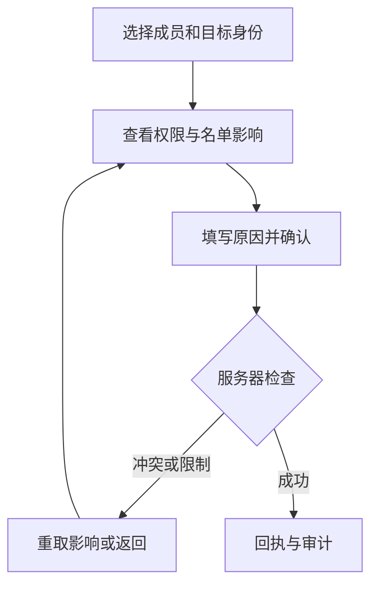

# 学会后台逐屏规范

创建与最近更新 2026-11-28 · MicroHub 审计基线 `32150ab4bdd46327f52e42e2431dfaa0b5198b95`

**Proposed**。本页每个界面全部适用 [状态](../INTERACTION_PATTERNS.md)、[响应式](../RESPONSIVE_DESIGN.md)、[双主题](../DESIGN_SYSTEM.md) 和 [无障碍](../ACCESSIBILITY.md)。手机列表→对象详情→确认；平板空间足够时并排；桌面工作区并排名单和详情，操作记录字段支持可读横向结构。两主题的危险语义、必填理由、键盘返回与读屏状态一致。

## SCR-20 独立申请审核

- 路由与实现 `/administration` · `app/administration.tsx`。目标角色 当前合法 admin/super_admin；会长等保留技术角色的权限。
- 目的与当前问题。固定 30 条的审核页；super_admin 可以转到已实现的 /club-admin。
- 目标布局与主操作。优先显示审核对象和队列定位；保留普通 Admin 和全权限管理层合法入口。
- 组件、次操作和跳转。Applications、Access、ConfirmDialog、分页及拟议 DataTable。
- 状态、权限及恢复。审核耗尽／并发已审、保护最后负责人、任免影响、非法邀请分别显示。
- 验收。写接口独立校验；31+ 队列可找；来源可信、理由必填，手机与桌面共享权限。
- 设计依据。GC-43、59。

## 目标子视图与邀请

权限功能已合入，以下为 **Proposed** 的界面改造。依据 `/club-admin` 现有六区和 `/administration` 申请队列，有限 section 可用于恢复当前面板（该 URL 参数为提议）。Home 已有邀请码兑换；补资料区与恢复反馈不增加接口权限。独立的带组交接版式可与现有 Groups 集成。

| ID · 提议 section       | 对象及布局                                 | 主要动作和状态                                             | 权限、证据与验收                                                                               |
| ----------------------- | ------------------------------------------ | ---------------------------------------------------------- | ---------------------------------------------------------------------------------------------- |
| ADM-B01 · overview      | 待审、待批、签到和变更摘要，时间及范围筛选 | 主动作进入当前有待办的队列；错误块局部重试，零与未知分开   | 全会与各组受 capability 检查。每个计数和跳转都能对照数据                                       |
| ADM-B02 · applications  | 申请收件箱→详情，昵称与身份分开            | 批准／拒绝及确认；被其他人处理就更新队列                   | 复用 review_membership 合同，当前 P1；31+ 记录可访问，无凭空批量审核                           |
| ADM-B03 · members       | 成员搜索、身份／小组／会籍筛选及摘要       | 查看授权字段，进入单人成员管理；改变筛选保留识别范围       | 普通成员无管理操作；区分资料停用、移除会籍与恢复入会                                           |
| ADM-B04 · appointment   | 当前角色、目标角色、影响、原因、确认、结果 | 预览尚待作业与进行中签到影响；并发冲突要求重取预览         | 会长／副会长在确认分支规定范围；保留已交、成绩、签到及更正历史；保护最后有效全权限管理员       |
| ADM-B05 · member-status | 账号停用与恢复、移除与恢复入会分区         | 显示影响和目标状态，服务器结果出现后更新；原因及确认按需求 | 停用与移除语义可区分，测试已缓存无法再查看私有历史                                             |
| ADM-B06 · committee     | 岗位列表及持有人，显示其业务权限归属       | 查找与任命，明确委员会职位对技术权限的实际影响             | 避免职位误授功能；保留组内职责来源，冲突可重试                                                 |
| ADM-B07 · handover      | 小组、现负责人、候选人及受影响范围         | 指定接任人、校验原因和预览→确认→审计结果                   | 带组权限跟服务器交接结果更新，两端一致；原有组历史仍可由合法人员查看                           |
| ADM-B08 · club          | 学会单例资料、名称、可用 Logo              | 更名及 Logo 选择、预览、保存；文件错误就地修复             | 仅有权人员编辑，旧 Logo 未更新前维持；不显示新增学会                                           |
| ADM-B09 · audit         | 时间、操作、决定者、范围过滤，行详情       | 分页及筛选，必要时查看获授权的原因及差异                   | 审计不可编辑；保留最小化展示，无秘密或过度 PII                                                 |
| ADM-B10 · invitations   | 已创建、新鲜、已用、已撤销或已过期         | 生成、复制及撤销，默认 7 天；显示状态、到期及合法错误      | 仅全权限管理者，码不得流入日志或随意显示，重复请求复核                                         |
| ADM-B11 · member Home   | 学校邮箱验证后显示邀请码或入会申请         | 填写中英文姓名、班级及邀请码，确认、等服务器、回执         | 符合学生条件方可兑换；一次性，事务同时兑换、入会、结清待审；到期、失效、已用及网络竞态均可恢复 |

## SCR-25 学会后台

- 现有 `/club-admin` 对应 `app/club-admin.tsx` 与 `src/features/club/manage.tsx`。授权社会角色进入的是技术角色 super_admin；普通 Admin 保留 `/administration` 的合法审核权限。原研教、会长、副会长显示对应 office。
- 现有六区由 ClubAdmin 的 Choices 提供，包含 Overview、MemberList、Invites、Positions、Settings、History。概览进入原有审核或带筛选的成员与邀请码。后台按 ADM-B01…11 的业务场景重构。现有带组操作分布在 versioned 成员管理与 Groups，保留两种入口原有作用。
- 复用 `club_admin_panel`、`club_member_change`、`club_invite_issue/revoke/redeem`、`club_position_save`、`update_club`、`group_change` 及 profile-avatar 的 Logo 授权。用实际响应给成功结果，PGRST202 有迁移待核状态；身份、组、任免预览和服务端版本要一致。后台目前的风险见 UX-017…020。
- 手机上一次只聚焦一组工作，让手机键盘和对话框有安全区。平板可保留筛选与当前列表，桌面列表旁并排对象或日志详情。Light/Dark 都使用相同语义的表面和文字；复制码不依赖低对比文字提示，正文可读屏。
- 验收包含用正常 Admin 访问审核、拒绝全权后台；两个独立管理会话的冲突恢复、岗位关联、Logo 私有权限和口令状态；保留合格的关联小组，以及切换面板、通过概览深链、返回到已核验筛选位置。Classroom 参考 GC-43 的人员结构与 GC-59 的权限范围。
