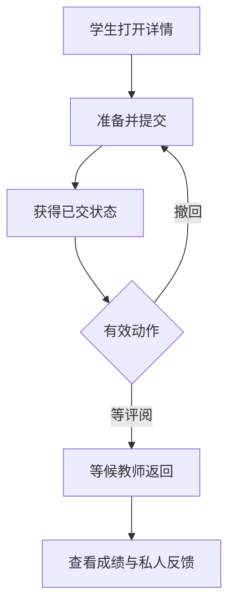
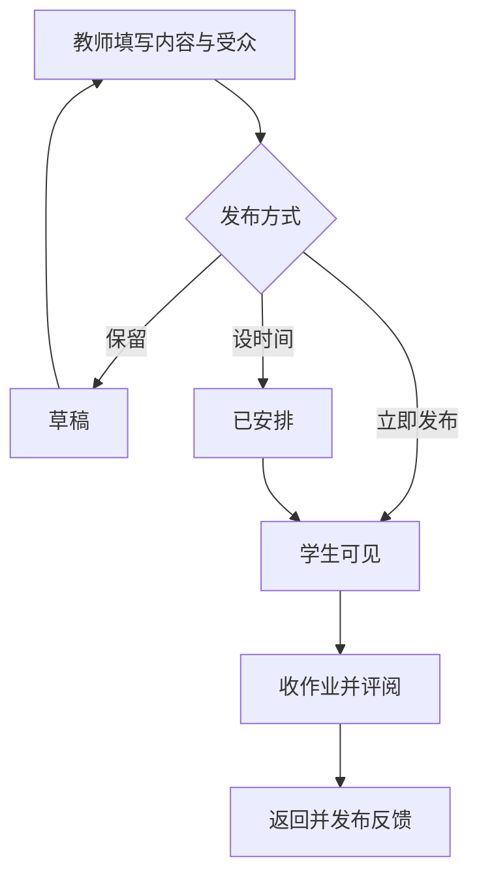
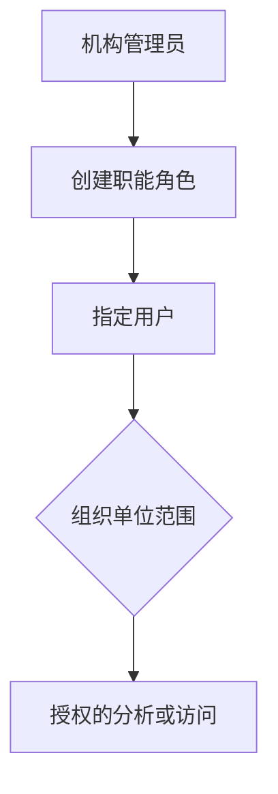

# Classroom 用户流程

创建与最近更新 2026-11-28 · MicroHub 审计基线 `32150ab4bdd46327f52e42e2431dfaa0b5198b95`

计数起点为表内页面。每个箭头的命令为一个预计激活动作，不含打字、文件选择器内部操作、Google 登录子步骤、等待和可选分支。数字为按文档重建的 **INFERRED** 最短参考值。GF-17 的演示按钮为 **VERIFIED**。选择性字段与真实设备上的导航需单独计数。

| ID    | 起点／角色            | 路径和输入                                               |   次数 | 结果与恢复                                                           | 可迁移判断、证据                                      |
| ----- | --------------------- | -------------------------------------------------------- | -----: | -------------------------------------------------------------------- | ----------------------------------------------------- |
| GF-01 | Home／新学生          | 加号→Join class→输入代码→Join，另有邀请链接              |      3 | 加入后出现 class；遇资格或码错误先核对账号                           | 上下文明确；MicroHub 邮箱核验和申请／码分流。S01、S02 |
| GF-02 | Home／学生            | 班级卡→Stream，扫标题和公告内容                          |      1 | 进入公告所在范围；配置隐藏时从允许的入口查找                         | 简短；避免流里重复全部作业。S05、S07                  |
| GF-03 | Home／学生            | 班级卡→Classwork→选主题或条目                            |      3 | 展开后显示内容；更换主题可恢复                                       | 分类有效；MicroHub 支持状态、范围及直接详情。S05、S13 |
| GF-04 | 班级 Stream／学生     | Classwork→作业条目→View instructions                     |      3 | 展示作业、说明和 Your work；详情无权时需核对班级账号                 | 展开再进详情成本可减少。S15                           |
| GF-05 | 作业详情／学生        | Add or create→选附件来源→Turn in→确认，另可 Mark as done |      4 | Turned in；错附件可提交前删除；上传失败 UI 待测                      | 区分编辑和服务器回执。S15                             |
| GF-06 | 已交详情／学生        | Unsubmit→确认→改内容→Turn in→确认                        |      4 | 回到已交，可能变迟；在截止前完成重交                                 | 页面显示时间后果，遵守本仓库修订。S15                 |
| GF-07 | 班级 Stream／学生     | Classwork→View your work→选已返还作业                    |      3 | 看已发布分数；未见值先看是否已返还                                   | 收到反馈直接跳转私有记录。S18、S16                    |
| GF-08 | 作业详情／学生        | 查看 Private comments；如回复则输入→发送                 |   0／1 | 查看私评或提交回复；敏感内容留在对象内                               | 继续区分评分反馈与参与者讨论。S15、S17                |
| GF-09 | 班级 Stream／学生     | Classwork→选 Material→选附件                             |      3 | 文件来源可能在另一应用；核对访问权限                                 | 现有附件支持明确去向。S05、S12                        |
| GF-10 | Android 应用／师生    | 通知入口→提醒→目标内容                                   |      2 | 找到关联内容；文档未确认失效跳转处理                                 | MicroHub 保留列表返回位置。S23                        |
| GF-11 | Stream／教师          | 撰写框→配置对象、输入→Post                               |   2 起 | 发布后可见；从菜单保存草稿或定时另加操作                             | 显示准确受众；错误后保留已填内容。S07                 |
| GF-12 | Stream／教师          | Classwork→Create→Assignment→填必需项→Assign              |   4 起 | 发布；对象和日期选项变化会加操作                                     | 作者视图按内容和受众分组。S09                         |
| GF-13 | Classwork／教师       | 作业→待批人数→学生→评分／反馈→Return                     |   4 起 | 学生收到返还；可改间接发布并查历史                                   | 保持私有草稿和选择稳定。S16、S17                      |
| GF-14 | Classwork／教师       | 作业→Assigned 人数→筛选 Missing（如适用）                |    2–3 | 看未交名单；双计数为零时无此入口                                     | 明确零状态和统计分母。S16、S40                        |
| GF-15 | 班级 Stream／有权教师 | People→邀请旁按钮→选人→Invite；移除从选择人员及菜单开始  |   4 起 | 待接受或名单变化；找不到身份则核对域／教师资格                       | 目录与危险任免不同。S06、S25、S34                     |
| GF-16 | 班级 Stream／教师     | Settings 齿轮→Stream 策略→选项→Save                      |      4 | 保存权限配置；取消／网络失败状态待测                                 | 操作前显示限制范围和影响。S08                         |
| GF-17 | 官方公开演示／未登录  | Start Demo→Next                                          | 2 实测 | 章节目录与控制出现，中央由资源入口示意变成题名操作；可后退或审阅文字 | 有范围的可恢复步骤。S44、E15                          |

管理员图来自 E16。授权实际效果为 OFFICIAL，未在租户执行。
